<div align="center">

# 📉 Predicción de Abandono de Clientes de Telecomunicaciones

**¿Qué cliente va a irse? Un modelo que ordena a los clientes por riesgo de abandono para priorizar las llamadas de retención.**

Proceso completo de Machine Learning sobre el dataset Iranian Churn: análisis exploratorio, partición por grupos de perfiles, comparación de 12 clasificadores con 4 estrategias de balanceo, controles de rigor contra la fuga de información y publicación del mejor modelo en una app web con Gradio.


</div>

---

## Tabla de contenido

1. [Descripción del proyecto](#descripción-del-proyecto)
2. [Equipo](#equipo)
3. [El problema](#el-problema)
4. [Dataset](#dataset)
5. [Pipeline de Machine Learning](#pipeline-de-machine-learning)
6. [Modelos y estrategias de balanceo](#modelos-y-estrategias-de-balanceo)
7. [Estructura del repositorio](#estructura-del-repositorio)
8. [Stack tecnológico](#stack-tecnológico)
9. [Decisiones técnicas](#decisiones-técnicas)
10. [Puesta en marcha en local (recomendado)](#puesta-en-marcha-en-local-recomendado)
11. [Ejecución en Google Colab](#ejecución-en-google-colab)
12. [App web](#app-web)
13. [Resultados](#resultados)
14. [Informe y presentación](#informe-y-presentación)
15. [Trabajo con agentes de IA](#trabajo-con-agentes-de-ia)
16. [Solución de problemas](#solución-de-problemas)
17. [Limitaciones conocidas](#limitaciones-conocidas)
18. [Mejoras futuras](#mejoras-futuras)
19. [Referencias](#referencias)

---

## Descripción del proyecto

Una empresa de telecomunicaciones no puede llamar a todos sus clientes para ofrecerles algo que los haga quedarse: necesita saber a quién llamar primero. Este proyecto usa el uso del servicio durante los primeros **nueve meses** de la suscripción para predecir si un cliente **abandonará en el mes doce**, con el fin de priorizar los contactos de retención hacia los clientes de mayor riesgo.

El reto no es solo el desbalance de clases (solo el **15,7%** de los clientes abandona), sino también que el conjunto trae **cientos de clientes con el mismo perfil de entrada** repetido con identificadores distintos, sin que su origen esté documentado. Partir los datos al azar dejaría el mismo perfil en entrenamiento y en prueba, inflando el resultado. Por eso la partición y la validación cruzada **agrupan los perfiles idénticos**, y un cuaderno completo (05) pone a prueba el resultado final con controles de fuga de información antes de confiar en él.

Proyecto final de **Fundamentos de Inteligencia Artificial** — Universidad EIA, 2026-2.

## Equipo

| Integrante | GitHub |
| :--- | :--- |
| Juan Jose Jaramillo Mora | [@Juanjo1414](https://github.com/Juanjo1414) |
| Sebastian Giraldo Franco | [@sebasgiraldo69](https://github.com/sebasgiraldo69) |
| Martin Restrepo | [@martinrestrepoc](https://github.com/martinrestrepoc) |
| Miguel Angel Zuleta | [@miguel142434](https://github.com/miguel142434) |
| Julian Mora | [@julian95mora25](https://github.com/julian95mora25) |
| Santiago Zuluaga | [@santiago-zuluaga](https://github.com/santiago-zuluaga) |

## El problema

| Aspecto | Detalle |
| :--- | :--- |
| Tipo de tarea | Clasificación binaria supervisada |
| Entrada | 11 variables de los primeros 9 meses: quejas, antigüedad, nivel de cargo, uso (segundos, llamadas, SMS, números distintos), llamadas fallidas, plan tarifario, grupo de edad y edad |
| Salida | `abandono`: 1 = el cliente abandonó en el mes doce, 0 = permaneció |
| Desbalance | ~15,7% de abandono (495 de 3.150 clientes) |
| Métrica principal | F1 de la clase que abandona |
| Métricas secundarias | Recall, precisión, precisión promedio, ROC AUC y priorización (accuracy solo como referencia) |

## Dataset

**Iranian Churn Dataset** — datos de una empresa de telecomunicaciones iraní, publicados en el UCI Machine Learning Repository (id 563). Cada fila resume el uso del servicio de un cliente durante nueve meses y si abandonó o permaneció en el mes doce.

| Columna | Descripción | Tipo |
| :--- | :--- | :--- |
| `fallas_llamadas` | Llamadas fallidas | Numérica (conteo) |
| `quejas` | 0 sin queja; 1 con queja (no cuenta cuántas) | Binaria |
| `antiguedad` | Meses de suscripción | Numérica |
| `nivel_cargo` | Nivel de cargo, documentado de 0 a 9 (hay 7 clientes en nivel 10) | Ordinal |
| `segundos_uso` | Segundos de llamadas | Numérica |
| `frecuencia_uso` | Número de llamadas | Numérica (conteo) |
| `frecuencia_sms` | Número de mensajes | Numérica (conteo) |
| `numeros_distintos` | Números distintos llamados | Numérica (conteo) |
| `grupo_edad` | Grupo de edad, de 1 a 5 | Ordinal |
| `plan_tarifario` | 1 = pago por uso; 2 = contractual | Nominal binaria |
| `edad` | Edad (función exacta del grupo: 1→15, 2→25, 3→30, 4→45, 5→55) | Numérica |
| `abandono` | 1 = el cliente abandonó en el mes doce | Objetivo |

`Status` y `Customer Value` vienen en el archivo original pero **no se usan**: el conjunto no documenta con precisión cuándo se miden ni cómo se calculan, y no se puede descartar que ya reflejen el desenlace.

Fuente: [UCI Machine Learning Repository, id 563](https://archive.ics.uci.edu/dataset/563/iranian+churn+dataset) · Licencia CC BY 4.0.

## Pipeline de Machine Learning

El trabajo está dividido en seis notebooks, cada uno con una sola responsabilidad, y una app que consume el modelo final. Cada notebook guarda los archivos que necesita el siguiente.

```mermaid
flowchart LR
    subgraph Datos["Datos (UCI)"]
        RAW[("Iranian Churn")]
    end

    subgraph NB0["00 · Auditoría"]
        AUD["Esquema · nulos · duplicados\ndominios · Status/Customer Value"]
    end

    subgraph NB1["01 · EDA y limpieza"]
        EDA["Análisis exploratorio\nclase · quejas · phik"]
        GRP["Agrupar perfiles idénticos"]
        SPLIT["Partición por grupos\n80/20"]
    end

    subgraph NB2["02 · Escalado y selección"]
        ESC["Escalado\nsin escalar · MinMax · Standard"]
        PCA["PCA"]
        SEL["Selección ANOVA"]
    end

    subgraph NB3["03 · Balanceo y modelos"]
        CMP["12 modelos × 4 estrategias\nvalidación cruzada por grupos"]
    end

    subgraph NB4["04 · Ajuste y exportación"]
        GS["GridSearchCV + calibración"]
        NEST["Validación anidada\n5 externas × 5 internas"]
        TEST["Evaluación única en prueba"]
    end

    subgraph NB5["05 · Controles de rigor"]
        CTRL["Etiquetas mezcladas\nagrupación estricta · vecinos"]
    end

    subgraph APP["App"]
        GR["Gradio\nformulario · CSV · priorización"]
    end

    RAW --> AUD --> EDA --> GRP --> SPLIT
    SPLIT -- "train.csv · test.csv" --> ESC --> PCA --> SEL
    SEL -- "decisiones_preprocesamiento.joblib" --> CMP
    CMP -- "comparacion_modelos.csv" --> GS --> NEST --> TEST
    TEST -- "modelo_final.joblib\nmetadata_modelo.json" --> GR
    TEST -.-> CTRL
```



| Notebook | Qué hace | Genera |
| :--- | :--- | :--- |
| `00_Auditoria_Datos.ipynb` | Audita el archivo original: esquema, nulos, duplicados, dominios de cada columna, revisión de `Status` y `Customer Value` | `resultados/auditoria_*.csv`, `resultados/AUDITORIA.md` |
| `01_EDA_Limpieza_Churn.ipynb` | Explora el conjunto, agrupa los perfiles idénticos y separa entrenamiento/prueba por grupos | `data/train.csv`, `data/test.csv`, `data/test_original.csv`, grupos de entrenamiento |
| `02_Escalado_PCA_Seleccion_Churn.ipynb` | Compara escaladores, PCA y selección ANOVA con validación cruzada por grupos | `models/decisiones_preprocesamiento.joblib`, `resultados/comparacion_rasgos.csv` |
| `03_Balanceo_Comparacion_Modelos_Churn.ipynb` | Evalúa 12 modelos × 4 estrategias de balanceo (41 combinaciones) y controles de fuga/sobremuestreo | `resultados/comparacion_modelos.csv`, `resultados/03_candidatos.csv` |
| `04_Ajuste_Evaluacion_Exportacion_Churn.ipynb` | Ajusta los 3 candidatos, calibra probabilidades, elige umbral, hace validación **anidada**, evalúa en prueba una sola vez y exporta | `models/modelo_final.joblib`, `models/metadata_modelo.json`, `resultados/ajuste_hiperparametros.csv` |
| `05_Controles_Rigor_Churn.ipynb` | Integridad de la partición, etiquetas mezcladas al azar, agrupación más estricta de perfiles parecidos, vecinos cercanos | `resultados/05_*.csv` |
| `app.py` | Publica el modelo en una app web | — |

## Modelos y estrategias de balanceo

| Modelos individuales (8) | Ensambles (4) | Estrategias de balanceo (4) |
| :--- | :--- | :--- |
| KNN | Bagging | Sin balanceo |
| Naive Bayes | AdaBoost | `class_weight="balanced"` * |
| Árbol de decisión | Gradient Boosting | SMOTENC |
| Regresión logística | Stacking | Submuestreo aleatorio |
| SVM | | |
| SVM lineal | | |
| Red neuronal (MLP) | | |
| Random Forest | | |

\* `class_weight` solo aplica a los modelos que tienen ese parámetro: Árbol de decisión, Regresión logística, SVM, SVM lineal y Random Forest.

## Estructura del repositorio

```text
prediccion-abandono-clientes/
├── data/
│   ├── original/                          # Archivo original de UCI, sin modificar
│   ├── train.csv                          # Generado por el notebook 01 (2.511 filas)
│   ├── test.csv                           # Generado por el notebook 01 (639 filas)
│   ├── test_original.csv                  # Test con los valores originales, para la app
│   └── grupos_train.csv                   # Grupo de perfil de cada fila de entrenamiento
├── models/
│   ├── decisiones_preprocesamiento.joblib # Notebook 02 (escalador sin ajustar)
│   ├── modelo_final.joblib                # Notebook 04 (pipeline, calibrador, umbral, columnas)
│   └── metadata_modelo.json               # Notebook 04 (métricas, umbral, fecha)
├── resultados/                            # Tablas comparativas y de auditoría en CSV
├── figuras/                               # Gráficas para el informe y la presentación
├── informe/
│   ├── informe.html                       # Fuente del informe final (se imprime a PDF desde el navegador)
│   └── Informe_Final.pdf                  # Informe final
├── presentacion/
│   └── presentacion.html                  # Presentación interactiva (se abre en el navegador, sin servidor)
├── referencia/                            # Notebooks de clase usados como guía de estilo
├── 00_Auditoria_Datos.ipynb
├── 01_EDA_Limpieza_Churn.ipynb
├── 02_Escalado_PCA_Seleccion_Churn.ipynb
├── 03_Balanceo_Comparacion_Modelos_Churn.ipynb
├── 04_Ajuste_Evaluacion_Exportacion_Churn.ipynb
├── 05_Controles_Rigor_Churn.ipynb
├── app.py                                 # App web en Gradio
├── AGENTS.md                              # Reglas del proyecto para personas y agentes de IA
├── CLAUDE.md                              # Puente para Claude Code (importa AGENTS.md)
├── ESTADO.md                              # Avance, decisiones y bitácora
├── PLAN.md                                # Plan de implementación detallado
├── pyproject.toml
├── uv.lock
├── .python-version
└── .gitignore
```

## Stack tecnológico

| Capa | Tecnología |
| :--- | :--- |
| Lenguaje | Python 3.11 |
| Datos y análisis | pandas, NumPy, SciPy |
| Visualización | Matplotlib, Seaborn, phik (correlación con variables categóricas) |
| Machine Learning | scikit-learn (pipelines, PCA, selección ANOVA, 12 clasificadores, GridSearchCV, validación anidada) |
| Balanceo de clases | imbalanced-learn (SMOTENC, RandomUnderSampler, Pipeline) |
| Validación por grupos | `StratifiedGroupKFold` (perfiles idénticos nunca cruzan entrenamiento/validación) |
| Persistencia del modelo | joblib, JSON |
| App web | Gradio |
| Entorno | uv (`pyproject.toml` + `uv.lock`), Jupyter en VS Code, Google Colab |

## Decisiones técnicas

- **F1 de la clase que abandona como métrica principal.** Con 15,7% de positivos el accuracy ya no engaña tanto como en un desbalance extremo, pero sigue premiando al modelo que nunca avisa (84,4% de accuracy con F1 = 0).
- **Agrupar perfiles idénticos antes de partir.** El conjunto trae 300 filas repetidas exactamente y cientos de clientes con el mismo perfil de entrada e identificadores distintos. Partir al azar dejaría el mismo perfil en entrenamiento y prueba, inflando el resultado. La partición y las 10 particiones de validación cruzada agrupan esos perfiles.
- **Balanceo dentro del pipeline.** SMOTENC y el submuestreo van dentro de un `Pipeline` de imbalanced-learn, ajustados solo con los datos de entrenamiento de cada partición.
- **`Status` y `Customer Value` fuera del modelo.** Se dejaron fuera por falta de documentación sobre su construcción, no porque se haya demostrado que filtran el desenlace; tampoco se reintrodujeron para mejorar el resultado.
- **Set de prueba reservado.** El 20% de prueba se separa una vez en el notebook 01 (respetando los grupos) y solo se usa al final del notebook 04.
- **Calibración de probabilidades.** El balanceo distorsiona las probabilidades del modelo; se calibran con una curva sigmoide ajustada sobre predicciones fuera de pliegue, para que la app pueda mostrar un riesgo interpretable.
- **Validación anidada.** Antes de confiar en el F1 de desarrollo, se repite todo el procedimiento (hiperparámetros, calibración y umbral) dentro de una validación anidada (5 particiones externas × 5 internas, por grupos), para estimar el rendimiento de todo el procedimiento y no solo del modelo ya elegido con los mismos datos.
- **Controles de rigor (notebook 05).** Un F1 de 0,857 exige desconfiar: se comprobó que no hay perfiles compartidos entre entrenamiento y prueba, que las etiquetas mezcladas al azar hunden el ROC AUC a 0,49 (sin fuga mecánica) y que, al agrupar clientes parecidos y no solo idénticos, el F1 baja de 0,859 a 0,811. Por eso el resultado final se reporta como un rango (0,81–0,86).

## Puesta en marcha en local (recomendado)

Requisitos: Git, Visual Studio Code con las extensiones [Python](https://marketplace.visualstudio.com/items?itemName=ms-python.python) y [Jupyter](https://marketplace.visualstudio.com/items?itemName=ms-toolsai.jupyter), y [uv](https://docs.astral.sh/uv/). No es necesario instalar Python manualmente: uv descarga la versión 3.11 indicada en `.python-version`.

### 1. Instalar uv

```powershell
# Windows (PowerShell)
powershell -ExecutionPolicy ByPass -c "irm https://astral.sh/uv/install.ps1 | iex"
```

```bash
# macOS / Linux
curl -LsSf https://astral.sh/uv/install.sh | sh
```

Cierra y abre la terminal, y verifica con `uv --version`.

### 2. Clonar el repositorio e instalar las dependencias

```bash
git clone <url-del-repositorio>
cd prediccion-abandono-clientes
uv sync
```

`uv sync` crea el entorno virtual `.venv` con Python 3.11 e instala exactamente las versiones registradas en `uv.lock`. Verifica con `uv run python --version`.

El dataset ya viene incluido en el repositorio (`data/original/`).

### 3. Seleccionar el kernel en VS Code

Abre la carpeta del proyecto en VS Code, abre `00_Auditoria_Datos.ipynb` y en **Select Kernel → Python Environments** elige el intérprete de `.venv`:

- Windows: `.venv\Scripts\python.exe`
- macOS / Linux: `.venv/bin/python`

### 4. Ejecutar los notebooks en orden

Verifica que la primera celda de cada notebook tenga `EN_COLAB = False` y ejecuta cada uno con **Run All**:

```text
00_Auditoria_Datos → 01_EDA_Limpieza_Churn → 02_Escalado_PCA_Seleccion_Churn → 03_Balanceo_Comparacion_Modelos_Churn → 04_Ajuste_Evaluacion_Exportacion_Churn → 05_Controles_Rigor_Churn
```

El notebook 03 evalúa 41 combinaciones de modelo y balanceo con validación cruzada por grupos, y el 04 hace además una validación anidada, así que ambos tardan varios minutos (el 04, unos 26 en un computador normal).

También se pueden ejecutar desde la terminal:

```bash
uv run jupyter nbconvert --to notebook --execute --inplace 00_Auditoria_Datos.ipynb --ExecutePreprocessor.timeout=-1
```

## Ejecución en Google Colab

1. Sube la carpeta del proyecto a Google Drive con el nombre `Prediccion_Abandono_Clientes`.
2. Abre el notebook en Colab y cambia `EN_COLAB = True` en la primera celda. La celda monta Drive y ajusta las rutas automáticamente.
3. Instala las librerías que Colab no trae por defecto:

```python
!pip install phik gradio imbalanced-learn -q
```

> Esta ejecución en Colab todavía no se ha probado de punta a punta; ver `ESTADO.md`.

## App web

```bash
uv run python app.py
```

La app se abre en `http://127.0.0.1:7860` y tiene tres pestañas:

| Pestaña | Qué hace |
| :--- | :--- |
| **Evaluar un cliente** | Formulario con las once entradas del modelo, con su descripción. Muestra el riesgo estimado en %, un veredicto según el umbral y los factores que más empujan el riesgo de ese cliente (comparando contra la mediana de entrenamiento). Botones de ejemplo cargan un cliente tranquilo, uno en el límite del umbral, uno en riesgo alto o uno real al azar del set de prueba, mostrando qué ocurrió realmente |
| **Priorizar contactos** | Recibe un CSV con un cliente por fila (en español o con los nombres originales en inglés de UCI) y devuelve una tabla ordenada por riesgo, con resumen y archivo descargable |
| **Sobre el modelo** | Modelo, estrategia de balanceo, calibración, escalador, entradas, umbral, métricas de validación anidada y de prueba, fecha de entrenamiento, y la nota sobre el rango 0,81–0,86 |

En Colab, cambia `EN_COLAB = True` dentro de `app.py` y ejecútalo desde la carpeta del proyecto. Gradio genera un enlace público temporal (`*.gradio.live`).

> ⚠️ Proyecto académico. La app no estima si una oferta concreta evitará el abandono ni cuánto ahorraría hacerlo, y no reemplaza el criterio del equipo de retención.

## Resultados

**Preprocesamiento elegido:** `StandardScaler`, sin PCA ni selección de variables (ningún subconjunto de las once entradas superó usarlas todas).

**Modelo final:** Random Forest (400 árboles, profundidad máxima 15, hojas mínimas 1) con `class_weight="balanced"`, calibración sigmoide de las probabilidades y umbral de decisión de 0,37.

| Métrica | Validación anidada (train) | Set de prueba |
| :--- | :--- | :--- |
| F1 clase que abandona | 0,851 ± 0,076 | 0,857 |
| Recall | 0,890 | 0,874 |
| Precisión | 0,831 | 0,841 |
| ROC AUC | 0,982 | 0,982 |
| Precisión promedio | 0,900 | 0,933 |
| Brier | 0,037 | 0,035 |
| Accuracy | — | 0,953 |

En el set de prueba el modelo detecta **90 de los 103 abandonos** y da 17 falsas alarmas entre 536 clientes que permanecen. Un modelo que siempre diga "permanece" saca 0,839 de accuracy pero no detecta ninguno (F1 = 0). Contactando solo al 10% de los clientes con mayor riesgo (64 clientes), el 95% de verdad abandonaba y se cubría el 59% de los abandonos totales — 5,9 veces mejor que contactar al azar.

> **Nota de transparencia.** Un F1 de 0,857 es mucho más alto que el 0,59 de un modelo lineal con las mismas variables (la señal está en combinaciones como "queja y poco uso", que un modelo lineal no puede representar bien). Antes de confiar en ese número, el notebook 05 lo puso a prueba: sin evidencia de fuga mecánica (con etiquetas mezcladas al azar, ROC AUC 0,492), pero con una agrupación más estricta de clientes parecidos el F1 baja a 0,811. Por eso el resultado se reporta como un rango, **entre 0,81 y 0,86**, y no como una cifra exacta. Todo está explicado en el notebook 05 y en el informe.

## Informe y presentación

- **Informe final:** [`informe/Informe_Final.pdf`](informe/Informe_Final.pdf) (24 páginas). Su fuente es `informe/informe.html`; para regenerar el PDF basta con abrirlo en un navegador basado en Chromium e imprimir a PDF en tamaño A4 sin encabezados.
- **Presentación:** abre `presentacion/presentacion.html` en el navegador. Flechas o espacio para avanzar, `O` para la vista general, `N` para las notas del orador, `T` para el cronómetro y `F` para pantalla completa. Incluye gráficas interactivas con los resultados reales (mapa de las 41 combinaciones, deslizador del umbral, deslizador de priorización de contactos) y los controles de rigor del notebook 05.

## Solución de problemas

| Problema | Solución |
| :--- | :--- |
| VS Code no muestra `.venv` como kernel | Ejecuta `uv sync` desde la raíz, verifica que las extensiones Python y Jupyter estén habilitadas y usa **Python: Select Interpreter** para elegir `.venv` manualmente. Si no aparece, ejecuta **Developer: Reload Window** |
| `FileNotFoundError` al cargar los datos | Verifica que `data/original/` tenga el archivo de UCI y que `EN_COLAB = False` en local |
| `ModuleNotFoundError: imblearn` | El paquete se llama `imbalanced-learn`. En local ejecuta `uv sync`; en Colab, `!pip install imbalanced-learn -q` |
| La app no encuentra el modelo | Ejecuta los seis notebooks en orden antes de `app.py` |
| Falta una dependencia | No uses `pip install` en local. Agrégala con `uv add nombre-del-paquete` y haz commit de `pyproject.toml` y `uv.lock` |

## Limitaciones conocidas

- Los datos no traen fecha de medición, así que no se puede descartar por completo que alguna entrada (por ejemplo, uso igual a cero) ya refleje un abandono que ya había ocurrido.
- El control de agrupación estricta (notebook 05) muestra que parte del F1 (unos 0,05) depende de que clientes muy parecidos puedan quedar en ambos lados de la partición.
- `Status` y `Customer Value` se dejaron fuera por falta de documentación, no porque se haya demostrado que filtran el desenlace.
- Los datos son de una sola empresa de telecomunicaciones; no se sabe cómo se comportaría el modelo en otro periodo o mercado.
- El umbral de 0,37 maximiza el F1, pero el umbral adecuado depende de cuánto cueste contactar a un cliente frente a perderlo; no se estimó ese costo en este trabajo.
- El modelo ordena a los clientes por riesgo de abandono; no estima si una oferta de retención cambiaría ese riesgo ni cuánto ahorraría.

## Mejoras futuras

- Conseguir datos con fecha para validar con una partición temporal.
- Revisar `Status` y `Customer Value` con su definición oficial, para decidir con evidencia si pueden usarse.
- Costos asimétricos entre contactar de más y perder un cliente, y selección del umbral a partir de esos costos.
- Un diseño experimental (A/B) que mida si contactar a los clientes de mayor riesgo reduce el abandono real.
- Datos de otra empresa o periodo, y despliegue permanente de la app.

## Referencias

- *Iranian Churn Dataset* (2020) [Dataset]. UCI Machine Learning Repository, id 563. https://doi.org/10.24432/C5JW3Z
- [scikit-learn: documentación oficial](https://scikit-learn.org/stable/)
- [imbalanced-learn: documentación oficial](https://imbalanced-learn.org/stable/)
- [Gradio: documentación oficial](https://www.gradio.app/docs)
- [uv: documentación oficial](https://docs.astral.sh/uv/)
