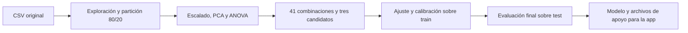

<div align="center">

# 📉 Predicción de Abandono de Clientes de Telecomunicaciones

**¿Qué cliente va a irse? Un modelo que ordena a los clientes por riesgo de abandono para priorizar las llamadas de retención.**

Proceso completo de Machine Learning sobre el dataset Iranian Churn: análisis exploratorio, partición estratificada 80/20 sin grupos, comparación de 12 clasificadores con 4 estrategias de balanceo, controles de rigor contra la fuga de información y publicación del mejor modelo en una app web con Gradio.


</div>

---

## Tabla de contenido

1. [Descripción del proyecto](#descripción-del-proyecto)
2. [Equipo](#equipo)
3. [El problema](#el-problema)
4. [Dataset](#dataset)
5. [Pipeline de Machine Learning](#pipeline-de-machine-learning)
6. [Modelos y estrategias de balanceo](#modelos-y-estrategias-de-balanceo)
7. [Estructura del repositorio](#estructura-del-repositorio)
8. [Stack tecnológico](#stack-tecnológico)
9. [Decisiones técnicas](#decisiones-técnicas)
10. [Puesta en marcha en local (recomendado)](#puesta-en-marcha-en-local-recomendado)
11. [Ejecución en Google Colab](#ejecución-en-google-colab)
12. [App web](#app-web)
13. [Resultados](#resultados)
14. [Informe y presentación](#informe-y-presentación)
15. [Solución de problemas](#solución-de-problemas)
16. [Limitaciones conocidas](#limitaciones-conocidas)
17. [Mejoras futuras](#mejoras-futuras)
18. [Referencias](#referencias)

---

## Descripción del proyecto

Una empresa de telecomunicaciones no puede llamar a todos sus clientes para ofrecerles algo que los haga quedarse: necesita saber a quién llamar primero. Este proyecto usa el uso del servicio durante los primeros **nueve meses** de la suscripción para predecir si un cliente **abandonará en el mes doce**, con el fin de priorizar los contactos de retención hacia los clientes de mayor riesgo.

El conjunto tiene un **15,7 % de abandono** y 300 filas repetidas, que se conservan. Los notebooks actuales usan `train_test_split` estratificado 80/20 y `StratifiedKFold` de 10 particiones, sin agrupar perfiles idénticos. Por tanto, un mismo perfil puede aparecer en entrenamiento y prueba. La revisión de los CSV encontró 86 perfiles compartidos, presentes en 102 de las 630 filas de prueba.

Proyecto final de **Fundamentos de Inteligencia Artificial** — Universidad EIA, 2026-2.

## Equipo

| Integrante | GitHub |
| :--- | :--- |
| Juan Jose Jaramillo Mora | [@Juanjo1414](https://github.com/Juanjo1414) |
| Sebastian Giraldo Franco | [@sebasgiraldo69](https://github.com/sebasgiraldo69) |
| Martin Restrepo | [@martinrestrepoc](https://github.com/martinrestrepoc) |
| Miguel Angel Zuleta | [@miguel142434](https://github.com/miguel142434) |
| Julian Mora | [@julian95mora25](https://github.com/julian95mora25) |
| Santiago Zuluaga | [@santiago-zuluaga](https://github.com/santiago-zuluaga) |

## El problema

| Aspecto | Detalle |
| :--- | :--- |
| Tipo de tarea | Clasificación binaria supervisada |
| Entrada | 13 variables de los primeros 9 meses, incluyendo estado y valor del cliente: quejas, antigüedad, nivel de cargo, uso (segundos, llamadas, SMS, números distintos), llamadas fallidas, plan tarifario, grupo de edad y edad |
| Salida | `abandono`: 1 = el cliente abandonó en el mes doce, 0 = permaneció |
| Desbalance | ~15,7% de abandono (495 de 3.150 clientes) |
| Métrica principal | F1 de la clase que abandona |
| Métricas secundarias | Recall, precisión, precisión promedio, ROC AUC y priorización (accuracy solo como referencia) |

## Dataset

**Iranian Churn Dataset** — datos de una empresa de telecomunicaciones iraní, publicados en el UCI Machine Learning Repository (id 563). Cada fila resume el uso del servicio de un cliente durante nueve meses y si abandonó o permaneció en el mes doce.

| Columna | Descripción | Tipo |
| :--- | :--- | :--- |
| `fallas_llamadas` | Llamadas fallidas | Numérica (conteo) |
| `quejas` | 0 sin queja; 1 con queja (no cuenta cuántas) | Binaria |
| `antiguedad` | Meses de suscripción | Numérica |
| `nivel_cargo` | Nivel de cargo, documentado de 0 a 9 (hay 7 clientes en nivel 10) | Ordinal |
| `segundos_uso` | Segundos de llamadas | Numérica |
| `frecuencia_uso` | Número de llamadas | Numérica (conteo) |
| `frecuencia_sms` | Número de mensajes | Numérica (conteo) |
| `numeros_distintos` | Números distintos llamados | Numérica (conteo) |
| `grupo_edad` | Grupo de edad, de 1 a 5 | Ordinal |
| `plan_tarifario` | 1 = pago por uso; 2 = contractual | Nominal binaria |
| `edad` | Edad (función exacta del grupo: 1→15, 2→25, 3→30, 4→45, 5→55) | Numérica |
| `estado` | 1 activo; 2 no activo | Categórica binaria |
| `valor_cliente` | Valor calculado; fórmula y unidad no detalladas por UCI | Numérica |
| `abandono` | 1 = el cliente abandonó en el mes doce | Objetivo |

**Se incluyen `Status` (`estado`) y `Customer Value` (`valor_cliente`) en el nuevo cuaderno paso a paso.** [UCI](https://archive.ics.uci.edu/dataset/563/iranian+churn+dataset) indica que todas las entradas corresponden a los primeros nueve meses y Churn al mes doce. `estado` es categórica (1 activo, 2 no activo). `valor_cliente` es numérica; no se publica su fórmula ni su unidad. La decisión anterior de excluirlas queda sustituida para este flujo.

Fuente: [UCI Machine Learning Repository, id 563](https://archive.ics.uci.edu/dataset/563/iranian+churn+dataset) · Licencia CC BY 4.0.

## Pipeline de Machine Learning

**El desarrollo actual está en `Churn_Paso_a_Paso.ipynb`, con fases 1 y 2 completas y 13 entradas.** Las fases 3–12 están pendientes. Los notebooks 01–04, `Modelo_Churn_Completo.ipynb`, el modelo exportado y la app corresponden a la versión anterior de 11 entradas y se conservan como respaldo. Sus exclusiones y resultados no describen el nuevo flujo.

El flujo completo anterior está en **`Modelo_Churn_Completo.ipynb`**. Integra las etapas de los notebooks 01–04 y transmite datos, preparación y candidatos en memoria. Para ejecutarlo solo necesita `data/original/Customer Churn.csv`; no requiere CSV intermedios ni decisiones guardadas por otros cuadernos.



Las funciones y el catálogo de 12 modelos se definen una sola vez. Todos los modelos tienen grilla de ajuste, incluido Bagging. La validación usa diez particiones estratificadas, sin grupos, y el balanceo ocurre antes de la transformación elegida dentro de cada pliegue.

- **Salida habitual:** `models/modelo_final.joblib`, `models/metadata_modelo.json`, `data/train.csv`, `data/test.csv` y `resultados/04_priorizacion_test.csv`. Los tres CSV se exportan para la app; no se leen para pasar entre etapas del cuaderno.
- **Tablas y figuras:** se muestran en el cuaderno. Activa `GUARDAR_TABLAS` o `GUARDAR_FIGURAS` para exportarlas también por separado.
- **Punto de comparación opcional:** activa `GUARDAR_PUNTO_COMPARACION` para guardar `models/punto_comparacion_churn.joblib`. En una ejecución posterior, `REANUDAR_COMPARACION=True` permite saltar a la etapa de ajuste. Regenera el punto si cambias código, datos o dependencias.
- **Auditoría:** `00_Auditoria_Datos.ipynb` sigue separado y se puede repetir cuando cambie el original.
- **Originales:** los notebooks 01–04 se conservan como referencia y alternativa modular. El 05 corresponde a controles históricos y no se incorpora a este flujo.

El calibrador ajustado con puntajes fuera de pliegue se conserva junto al umbral elegido; solo el modelo base se reentrena con todo train. Se exportan `metricas_seleccion_entrenamiento` y `metricas_comparacion_previa` por separado: la desviación del modelo anterior al ajuste no acompaña al F1 ajustado. No se exportan métricas llamadas anidadas. Persisten perfiles repetidos entre conjuntos y selección sin validación anidada. El test ya se consultó para diagnosticar la calibración; la reevaluación no es una validación nueva intacta. El informe, la presentación y las secciones históricas de esta documentación requieren actualización independiente.

## Modelos y estrategias de balanceo

| Modelos individuales (8) | Ensambles (4) | Estrategias de balanceo (4) |
| :--- | :--- | :--- |
| KNN | Bagging | Sin balanceo |
| Naive Bayes | AdaBoost | `class_weight="balanced"` * |
| Árbol de decisión | Gradient Boosting | SMOTENC |
| Regresión logística | Stacking | Submuestreo aleatorio |
| SVM | | |
| SVM lineal | | |
| Red neuronal (MLP) | | |
| Random Forest | | |

\* `class_weight` solo aplica a los modelos que tienen ese parámetro: Árbol de decisión, Regresión logística, SVM, SVM lineal y Random Forest.

## Estructura del repositorio

```text
prediccion-abandono-clientes/
├── data/
│   ├── original/                          # Archivo original de UCI, sin modificar
│   ├── train.csv                          # Generado por el notebook 01 (2.520 filas)
│   ├── test.csv                           # Generado por el notebook 01 (630 filas)
│   ├── test_original.csv                  # Test con los valores originales, para la app
│   └── grupos_train.csv                   # Archivo histórico; no usado por los notebooks 01–04 actuales
├── models/
│   ├── decisiones_preprocesamiento.joblib # Notebook 02 (escalador sin ajustar)
│   ├── modelo_final.joblib                # Notebook 04 (pipeline, calibrador, umbral, columnas)
│   └── metadata_modelo.json               # Notebook 04 (métricas, umbral, fecha)
├── resultados/                            # Tablas comparativas y de auditoría en CSV
├── figuras/                               # Gráficas para el informe y la presentación
├── informe/
│   ├── informe.html                       # Fuente del informe final (se imprime a PDF desde el navegador)
│   └── Informe_Final.pdf                  # Informe final
├── presentacion/
│   └── presentacion.html                  # Presentación interactiva (se abre en el navegador, sin servidor)
├── referencia/                            # Notebooks de clase usados como guía de estilo
├── Modelo_Churn_Completo.ipynb             # Flujo principal integrado
├── 00_Auditoria_Datos.ipynb
├── 01_EDA_Limpieza_Churn.ipynb
├── 02_Escalado_PCA_Seleccion_Churn.ipynb
├── 03_Balanceo_Comparacion_Modelos_Churn.ipynb
├── 04_Ajuste_Evaluacion_Exportacion_Churn.ipynb
├── 05_Controles_Rigor_Churn.ipynb
├── app.py                                 # App web en Gradio
├── AGENTS.md                              # Reglas del proyecto para personas y agentes de IA
├── CLAUDE.md                              # Puente para Claude Code (importa AGENTS.md)
├── ESTADO.md                              # Avance, decisiones y bitácora
├── PLAN.md                                # Plan de implementación detallado
├── pyproject.toml
├── uv.lock
├── .python-version
└── .gitignore
```

## Stack tecnológico

| Capa | Tecnología |
| :--- | :--- |
| Lenguaje | Python 3.11 |
| Datos y análisis | pandas, NumPy, SciPy |
| Visualización | Matplotlib, Seaborn, phik (correlación con variables categóricas) |
| Machine Learning | scikit-learn (pipelines, PCA, selección ANOVA, 12 clasificadores, GridSearchCV, validación estratificada) |
| Balanceo de clases | imbalanced-learn (SMOTENC, RandomUnderSampler, Pipeline) |
| Validación cruzada | `StratifiedKFold` de 10 particiones sin grupos |
| Persistencia del modelo | joblib, JSON |
| App web | Gradio |
| Entorno | uv (`pyproject.toml` + `uv.lock`), Jupyter en VS Code, Google Colab |

## Decisiones técnicas

- **F1 de la clase que abandona como métrica principal.** Con 15,7% de positivos el accuracy ya no engaña tanto como en un desbalance extremo, pero sigue premiando al modelo que nunca avisa (84,4% de accuracy con F1 = 0).
- **Partición estratificada sin grupos.** Se conservan las repeticiones y se mantiene la proporción de abandono con `stratify=y`. No se garantiza separación de perfiles idénticos.
- **Balanceo dentro del pipeline.** SMOTENC y el submuestreo van dentro de un `Pipeline` de imbalanced-learn, ajustados solo con los datos de entrenamiento de cada partición.
- **13 entradas en el cuaderno paso a paso.** Se conservan `estado` y `valor_cliente` siguiendo el periodo de observación documentado por UCI. Esta decisión sustituye la exclusión anterior y no se basa en mejorar el F1.
- **Set de prueba reservado.** El 20 % se separa en el notebook 01 con semilla 42 y se utiliza para la evaluación final en el 04.
- **Calibración de probabilidades.** El balanceo distorsiona las probabilidades del modelo; se calibran con una curva sigmoide ajustada sobre predicciones fuera de pliegue, para que la app pueda mostrar un riesgo interpretable.
- **Validación estratificada.** Los notebooks 02–04 usan diez particiones sin grupos. La versión actual no realiza validación anidada.
- **Controles históricos (notebook 05).** Corresponden a una partición anterior y no demuestran ausencia de perfiles compartidos en la propuesta actual.

## Puesta en marcha en local (recomendado)

Requisitos: Git, Visual Studio Code con las extensiones [Python](https://marketplace.visualstudio.com/items?itemName=ms-python.python) y [Jupyter](https://marketplace.visualstudio.com/items?itemName=ms-toolsai.jupyter), y [uv](https://docs.astral.sh/uv/). No es necesario instalar Python manualmente: uv descarga la versión 3.11 indicada en `.python-version`.

### 1. Instalar uv

```powershell
# Windows (PowerShell)
powershell -ExecutionPolicy ByPass -c "irm https://astral.sh/uv/install.ps1 | iex"
```

```bash
# macOS / Linux
curl -LsSf https://astral.sh/uv/install.sh | sh
```

Cierra y abre la terminal, y verifica con `uv --version`.

### 2. Clonar el repositorio e instalar las dependencias

```bash
git clone <url-del-repositorio>
cd prediccion-abandono-clientes
uv sync
```

`uv sync` crea el entorno virtual `.venv` con Python 3.11 e instala exactamente las versiones registradas en `uv.lock`. Verifica con `uv run python --version`.

El dataset ya viene incluido en el repositorio (`data/original/`).

### 3. Seleccionar el kernel en VS Code

Abre la carpeta del proyecto en VS Code, abre `Modelo_Churn_Completo.ipynb` y en **Select Kernel → Python Environments** elige el intérprete de `.venv`:

- Windows: `.venv\Scripts\python.exe`
- macOS / Linux: `.venv/bin/python`

### 4. Ejecutar el cuaderno completo

Abre `Modelo_Churn_Completo.ipynb`, deja `EN_COLAB = False` y usa **Restart → Run All**. No necesitas ejecutar primero los notebooks 01–04. Los datos originales deben estar en `data/original/Customer Churn.csv`.

Si solo quieres repetir una etapa y mantienes el kernel activo, ejecuta esa sección y las posteriores. Para cerrar la sesión y retomarla desde el ajuste, usa el punto de comparación opcional descrito arriba. `REANUDAR_COMPARACION=False` siempre vuelve a calcular todo desde el original.

También puedes ejecutar el flujo desde la terminal:

```bash
uv run jupyter nbconvert --to notebook --execute --inplace Modelo_Churn_Completo.ipynb --ExecutePreprocessor.timeout=1200
```

## Ejecución en Google Colab

1. Sube la carpeta del proyecto a Google Drive con el nombre `Prediccion_Abandono_Clientes`.
2. Abre el notebook en Colab y cambia `EN_COLAB = True` en la primera celda. La celda monta Drive y ajusta las rutas automáticamente.
3. Instala las librerías que Colab no trae por defecto:

```python
!pip install phik gradio imbalanced-learn -q
```

> Esta ejecución en Colab todavía no se ha probado de punta a punta; ver `ESTADO.md`.

## App web

```bash
uv run python app.py
```

La app se abre en `http://127.0.0.1:7860` y tiene tres pestañas:

| Pestaña | Qué hace |
| :--- | :--- |
| **Evaluar un cliente** | Formulario con las once entradas del modelo, con su descripción. Muestra el riesgo estimado en %, un veredicto según el umbral y los factores que más empujan el riesgo de ese cliente (comparando contra la mediana de entrenamiento). Botones de ejemplo cargan un cliente tranquilo, uno en el límite del umbral, uno en riesgo alto o uno real al azar del set de prueba, mostrando qué ocurrió realmente |
| **Priorizar contactos** | Recibe un CSV con un cliente por fila (en español o con los nombres originales en inglés de UCI) y devuelve una tabla ordenada por riesgo, con resumen y archivo descargable |
| **Sobre el modelo** | Modelo, estrategia de balanceo, calibración, escalador, entradas, umbral, métricas de selección, comparación previa y prueba, fecha de entrenamiento y limitaciones |

En Colab, cambia `EN_COLAB = True` dentro de `app.py` y ejecútalo desde la carpeta del proyecto. Gradio genera un enlace público temporal (`*.gradio.live`).

> ⚠️ Proyecto académico. La app no estima si una oferta concreta evitará el abandono ni cuánto ahorraría hacerlo, y no reemplaza el criterio del equipo de retención.

## Resultados históricos de la versión anterior

**Esta sección conserva resultados anteriores y no describe los notebooks 01–04 actuales.** La propuesta actual selecciona StandardScaler + ANOVA k=10 y MLP sin balanceo, umbral 0,43; la salida guardada del 04 reporta F1 de prueba 0,8738. Su partición es estratificada sin grupos y no hay evaluación anidada.

**Preprocesamiento elegido:** `StandardScaler`, sin PCA ni selección de variables (ningún subconjunto de las once entradas superó usarlas todas).

**Modelo final:** Random Forest (400 árboles, profundidad máxima 15, hojas mínimas 1) con `class_weight="balanced"`, calibración sigmoide de las probabilidades y umbral de decisión de 0,37.

| Métrica | Validación anidada (train) | Set de prueba |
| :--- | :--- | :--- |
| F1 clase que abandona | 0,851 ± 0,076 | 0,857 |
| Recall | 0,890 | 0,874 |
| Precisión | 0,831 | 0,841 |
| ROC AUC | 0,982 | 0,982 |
| Precisión promedio | 0,900 | 0,933 |
| Brier | 0,037 | 0,035 |
| Accuracy | — | 0,953 |

En el set de prueba el modelo detecta **90 de los 103 abandonos** y da 17 falsas alarmas entre 536 clientes que permanecen. Un modelo que siempre diga "permanece" saca 0,839 de accuracy pero no detecta ninguno (F1 = 0). Contactando solo al 10% de los clientes con mayor riesgo (64 clientes), el 95% de verdad abandonaba y se cubría el 59% de los abandonos totales — 5,9 veces mejor que contactar al azar.

> **Nota de transparencia.** Un F1 de 0,857 es mucho más alto que el 0,59 de un modelo lineal con las mismas variables (la señal está en combinaciones como "queja y poco uso", que un modelo lineal no puede representar bien). Antes de confiar en ese número, el notebook 05 lo puso a prueba: sin evidencia de fuga mecánica (con etiquetas mezcladas al azar, ROC AUC 0,492), pero con una agrupación más estricta de clientes parecidos el F1 baja a 0,811. Por eso el resultado se reporta como un rango, **entre 0,81 y 0,86**, y no como una cifra exacta. Todo está explicado en el notebook 05 y en el informe.

## Informe y presentación

**Entregables históricos:** el HTML, el PDF y la presentación describen la versión anterior con agrupación. No deben presentarse como documentación de la propuesta actual; requieren actualización integral de resultados y metodología.

- **Informe final:** [`informe/Informe_Final.pdf`](informe/Informe_Final.pdf) (24 páginas). Su fuente es `informe/informe.html`; para regenerar el PDF basta con abrirlo en un navegador basado en Chromium e imprimir a PDF en tamaño A4 sin encabezados.
- **Presentación:** abre `presentacion/presentacion.html` en el navegador. Flechas o espacio para avanzar, `O` para la vista general, `N` para las notas del orador, `T` para el cronómetro y `F` para pantalla completa. Incluye gráficas interactivas con los resultados reales (mapa de las 41 combinaciones, deslizador del umbral, deslizador de priorización de contactos) y los controles de rigor del notebook 05.

## Solución de problemas

| Problema | Solución |
| :--- | :--- |
| VS Code no muestra `.venv` como kernel | Ejecuta `uv sync` desde la raíz, verifica que las extensiones Python y Jupyter estén habilitadas y usa **Python: Select Interpreter** para elegir `.venv` manualmente. Si no aparece, ejecuta **Developer: Reload Window** |
| `FileNotFoundError` al cargar los datos | Verifica que `data/original/` tenga el archivo de UCI y que `EN_COLAB = False` en local |
| `ModuleNotFoundError: imblearn` | El paquete se llama `imbalanced-learn`. En local ejecuta `uv sync`; en Colab, `!pip install imbalanced-learn -q` |
| La app no encuentra el modelo | Ejecuta `Modelo_Churn_Completo.ipynb` antes de `app.py` |
| Falta una dependencia | No uses `pip install` en local. Agrégala con `uv add nombre-del-paquete` y haz commit de `pyproject.toml` y `uv.lock` |

## Limitaciones conocidas

- Los datos no traen fecha de medición, así que no se puede descartar por completo que alguna entrada (por ejemplo, uso igual a cero) ya refleje un abandono que ya había ocurrido.
- Hay perfiles idénticos compartidos entre entrenamiento y prueba; los controles históricos del notebook 05 no validan la partición actual.
- `Status` y `Customer Value` se conservan en el nuevo flujo. La ficha no detalla el criterio operativo de inactividad ni la fórmula y unidad de Customer Value; son límites de interpretación, no una decisión de excluirlas.
- Los datos son de una sola empresa de telecomunicaciones; no se sabe cómo se comportaría el modelo en otro periodo o mercado.
- El umbral de 0,37 maximiza el F1, pero el umbral adecuado depende de cuánto cueste contactar a un cliente frente a perderlo; no se estimó ese costo en este trabajo.
- El modelo ordena a los clientes por riesgo de abandono; no estima si una oferta de retención cambiaría ese riesgo ni cuánto ahorraría.

## Mejoras futuras

- Conseguir datos con fecha para validar con una partición temporal.
- Ampliar la documentación del criterio de inactividad y de la fórmula de Customer Value; su inclusión en el nuevo flujo ya está acordada.
- Costos asimétricos entre contactar de más y perder un cliente, y selección del umbral a partir de esos costos.
- Un diseño experimental (A/B) que mida si contactar a los clientes de mayor riesgo reduce el abandono real.
- Datos de otra empresa o periodo, y despliegue permanente de la app.

## Referencias

- *Iranian Churn Dataset* (2020) [Dataset]. UCI Machine Learning Repository, id 563. https://doi.org/10.24432/C5JW3Z
- [scikit-learn: documentación oficial](https://scikit-learn.org/stable/)
- [imbalanced-learn: documentación oficial](https://imbalanced-learn.org/stable/)
- [Gradio: documentación oficial](https://www.gradio.app/docs)
- [uv: documentación oficial](https://docs.astral.sh/uv/)
